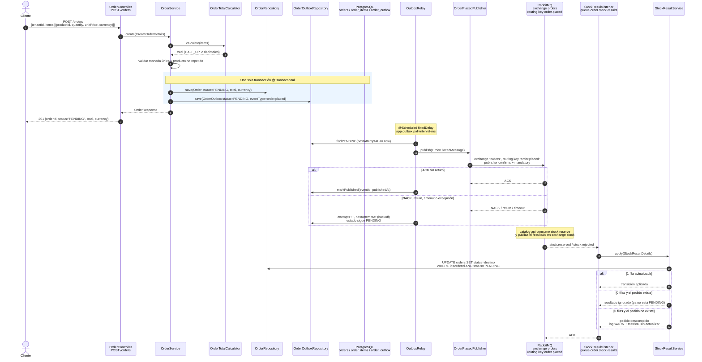

# UML 002 — Alta de pedido con outbox y publicación de order.placed

Este documento describe el desarrollo planificado para `order-api` según `spec.md`, `plan.md` y `tasks.md`. Los identificadores de Mermaid conservan los nombres previstos de clases, endpoints, colas y variables. La topología RabbitMQ (exchange, colas, bindings, TTL y DLQ) pertenece a `infra`; aquí solo se muestran los nombres usados por este servicio.

## Flujo principal (secuencia)

## Estructura de clases

```mermaid
classDiagram
    class OrderController {
        +orders() Map
        +create(CreateOrderRequest) OrderResponse
    }
    class OrderService {
        +create(CreateOrderDetails) Order
    }
    class OrderTotalCalculator {
        +calculate(List~OrderItemDetails~) BigDecimal
    }
    class StockResultService {
        +apply(StockResultDetails) void
    }
    class OutboxRelay {
        +relayPending() void
    }
    class OrderPlacedPublisher {
        +publish(OrderPlacedMessage) void
    }
    class StockResultListener {
        +onMessage(StockResultMessage) void
    }
    class ApiExceptionHandler {
        +handleInvalid(InvalidOrderException) ErrorResponse
    }

    class OrderRepository {
        +save(Order) Order
        +transitionStatus(UUID, OrderStatus, OrderStatus) int
        +existsById(UUID) boolean
    }
    class OrderOutboxRepository {
        +findPending(int) List~OrderOutbox~
        +markPublished(UUID, Instant) void
    }

    class Order {
        UUID id
        UUID tenantId
        OrderStatus status
        BigDecimal total
        Currency currency
        Instant createdAt
        List~OrderItem~ items
    }
    class OrderItem {
        UUID orderId
        UUID productId
        int quantity
        BigDecimal unitPrice
        Currency currency
    }
    class OrderOutbox {
        UUID eventId
        String eventType
        UUID aggregateId
        String payload
        OutboxStatus status
        Instant occurredAt
        Instant createdAt
        Instant publishedAt
        int attempts
        Instant nextAttemptAt
    }

    class OrderStatus {
        <<enumeration>>
        PENDING
        STOCK_RESERVED
        STOCK_REJECTED
    }
    class Currency {
        <<enumeration>>
        ARS
        USD
    }
    class OutboxStatus {
        <<enumeration>>
        PENDING
        PUBLISHED
    }

    class CreateOrderRequest {
        UUID tenantId
        List~OrderItemRequest~ items
    }
    class OrderItemRequest {
        UUID productId
        int quantity
        BigDecimal unitPrice
        Currency currency
    }
    class CreateOrderDetails {
        UUID tenantId
        List~OrderItemDetails~ items
    }
    class OrderItemDetails {
        UUID productId
        int quantity
        BigDecimal unitPrice
        Currency currency
    }
    class StockResultDetails {
        String eventType
        UUID orderId
    }
    class OrderResponse {
        UUID orderId
        OrderStatus status
        BigDecimal total
        Currency currency
    }
    class ErrorResponse {
        String code
        String message
        List~String~ fields
    }
    class OrderPlacedMessage {
        UUID eventId
        String eventType
        Instant occurredAt
        UUID orderId
        UUID tenantId
        List~OrderPlacedItemMessage~ items
        BigDecimal total
        Currency currency
    }
    class OrderPlacedItemMessage {
        UUID productId
        int quantity
        BigDecimal unitPrice
        Currency currency
    }
    class StockResultMessage {
        UUID eventId
        String eventType
        UUID orderId
        Instant reservedAt
        String reason
        Instant rejectedAt
    }

    OrderController --> OrderService
    OrderController ..> CreateOrderRequest
    OrderController ..> OrderResponse
    OrderService --> OrderRepository
    OrderService --> OrderOutboxRepository
    OrderService --> OrderTotalCalculator
    OrderService ..> CreateOrderDetails
    OrderService ..> OrderPlacedMessage
    OrderRepository --> Order
    Order "1" *-- "many" OrderItem
    Order --> OrderStatus
    Order --> Currency
    OrderOutbox --> OutboxStatus
    OrderOutboxRepository --> OrderOutbox
    OutboxRelay --> OrderOutboxRepository
    OutboxRelay --> OrderPlacedPublisher
    OrderPlacedPublisher ..> OrderPlacedMessage
    StockResultListener --> StockResultService
    StockResultListener ..> StockResultMessage
    StockResultService --> OrderRepository
    StockResultService ..> StockResultDetails
    ApiExceptionHandler ..> ErrorResponse
```

## Contrato y configuración de referencia

- Endpoint existente conservado: `GET /orders` bajo el prefijo `/orders` que aplica `config/ApiPathConfig.java`.
- Endpoint nuevo: `POST /orders`.
  - Entrada: `{ "tenantId": "uuid", "items": [ { "productId": "uuid", "quantity": 1, "unitPrice": 10.00, "currency": "ARS" } ] }`.
  - Salida 201: `{ "orderId": "uuid", "status": "PENDING", "total": 10.00, "currency": "ARS" }`.
  - Salida 400: `ErrorResponse` con código, mensaje y campos inválidos.
- Evento publicado: `order.placed` con `eventId`, `eventType`, `occurredAt`, `orderId`, `tenantId`, `items` (`productId`, `quantity`, `unitPrice`, `currency`), `total`, `currency`.
- Mensajes consumidos desde `order.stock-results`: `stock.reserved` (`eventId`, `orderId`, `reservedAt`) y `stock.rejected` (`eventId`, `orderId`, `reason`, `rejectedAt`).
- Persistencia: `orders`, `order_items` y `order_outbox` en la base PostgreSQL `orders`; migraciones nuevas `V2__add_order_currency_and_items.sql` y `V3__create_order_outbox.sql` sin editar `V1__create_orders.sql`.
- Configuración: se reutilizan `DATABASE_*`, `RABBITMQ_*`, `SERVER_PORT` y Actuator; se añaden defaults para `app.outbox.poll-interval-ms`, `app.outbox.batch-size`, `app.outbox.confirm-timeout-ms` y `app.rabbitmq.stock-results-queue` (`order.stock-results`).
- Estados: `PENDING -> STOCK_RESERVED` y `PENDING -> STOCK_REJECTED`; este último es terminal en la Fase 1.
